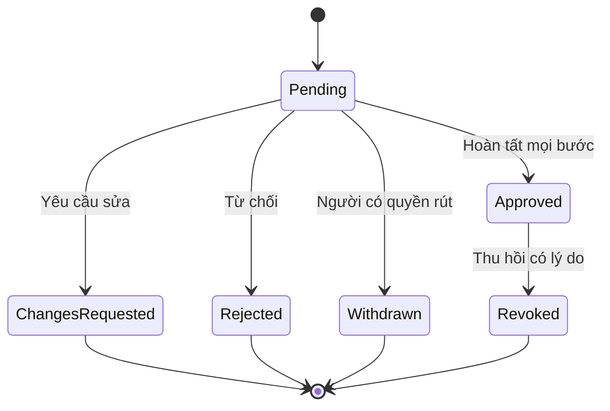
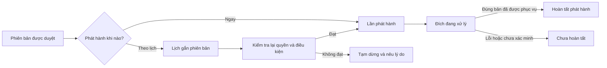
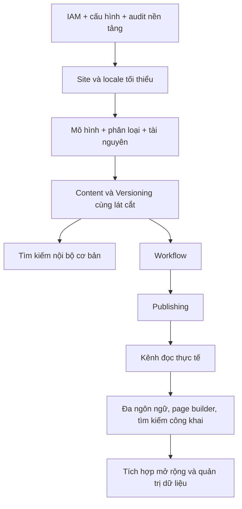

# Mô hình trạng thái và trách nhiệm

[Mục lục](README.md) · [Quy tắc chung](common-rules.md) · [Lộ trình](implementation-roadmap.md)

## Không gộp thành một trạng thái của bài viết

| Khái niệm | Ví dụ trạng thái hoặc giá trị | Domain chịu trách nhiệm |
|---|---|---|
| Nội dung | Đang sử dụng, đã lưu trữ | Content |
| Phiên bản dữ liệu | v1, v2, v3; bản lưu bất biến | Content và Versioning |
| Yêu cầu duyệt | Pending, Approved, ChangesRequested, Rejected, Withdrawn, Revoked | Workflow |
| Lịch | Scheduled, Paused, Executing, Completed, Failed, Cancelled | Publishing |
| Lần phân phối | Queued, Running, Succeeded, Failed, Cancelled | Publishing |
| Đợt nhiều đích | Chưa chạy, đang chạy, thành công, thất bại, hoàn tất một phần | Publishing |
| Bản đang phục vụ | Chưa có hoặc một bản phát hành cụ thể theo nội dung/site/locale/đích | Publishing và Site |
| Tài nguyên | Chờ kiểm tra, sẵn sàng, cách ly, lưu trữ | Assets |
| Độ mới bản dịch | Theo nguồn hiện hành, lỗi thời, đang rà soát | Localization |

Tên trạng thái là thuật ngữ đề xuất, không phải thiết kế enum hoặc schema đã chốt.

## Yêu cầu phê duyệt

Một lần sửa và gửi lại tạo yêu cầu mới.
Phiên bản đã được gửi không đổi dữ liệu.
Việc một yêu cầu kết thúc không làm mất bản đang công khai.

## Lịch và phát hành là luồng khác

Hủy lịch chỉ ngăn hành động chưa thắng bước chuyển bản.
Lịch đã thực thi phải xử lý bằng gỡ hoặc phát hành thay thế.
Một tác vụ cũ không được hồi sinh nội dung sau một hành động gỡ mới hơn.

## Ví dụ bắt buộc kiểm thử

| Tình huống | Kết quả mong muốn |
|---|---|
| v1 đang công khai; v2 mới được lưu | Người đọc vẫn nhận v1 |
| v2 được duyệt; v3 là nháp | Chỉ được dùng phê duyệt v2 cho v2 |
| Lịch chọn v2; sau đó có v3 | Lịch không tự chuyển sang v3 |
| v2 bị thu hồi duyệt trước khi chạy lịch | Lịch không phát hành v2 |
| Bản dịch en bị từ chối; ja đang công khai | ja không tự bị gỡ |
| Tệp ảnh v1 đang công khai; vừa tải v2 | Nội dung công khai không tự dùng v2 |
| Tác vụ phát hành cũ thử lại sau khi gỡ | Không làm bài xuất hiện trở lại |
| Khôi phục dữ liệu v2 khi hiện tại là v5 | Tạo v6 làm nháp; không viết lại v3-v5 |
| Site A thành công, site B lỗi trong cùng đợt | Đợt được báo hoàn tất một phần |

## Phụ thuộc không đồng nghĩa phải tách dịch vụ

Audit, phân quyền, phụ thuộc dữ liệu và kiểm tra lỗi đi xuyên mọi bước.
Sơ đồ thể hiện ưu tiên năng lực, không khẳng định tất cả bước phải chạy nối tiếp về nhân lực.
